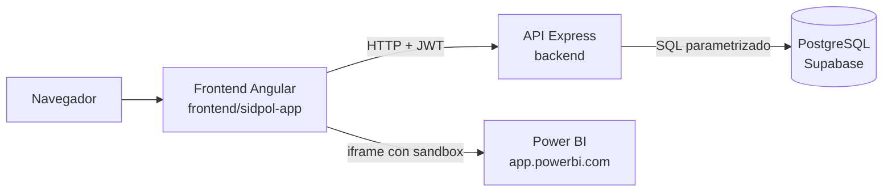

# Portal SIDPOL

Portal web de **Sistemas de Información Policial**. Centraliza los reportes de
Power BI (dashboards) de la institución y controla quién puede ver cada uno:
los usuarios entran con su cuenta y solo ven los módulos, submódulos y dashboards
que un administrador les asignó.

- **Frontend:** Angular 21 (componentes standalone, signals, Reactive Forms).
- **Backend:** API REST en Node.js con Express 5.
- **Base de datos:** PostgreSQL en Supabase.

## Arquitectura



El backend sigue capas **rutas → controladores → servicios → repositorios**, con
middlewares separados de autenticación, permisos, validación y errores. El frontend
se organiza en **core / shared / features**. Detalle:

| Documento                                                      | Contenido                                                                |
| -------------------------------------------------------------- | ------------------------------------------------------------------------ |
| [docs/arquitectura-backend.md](docs/arquitectura-backend.md)   | Carpetas, flujo de una petición y descripción de cada capa del backend   |
| [docs/arquitectura-frontend.md](docs/arquitectura-frontend.md) | Carpetas, flujo y descripción de cada parte del frontend                 |
| [docs/base-de-datos.md](docs/base-de-datos.md)                 | Diagrama ER, tablas, criterio de nombres y migraciones                   |
| [docs/validaciones.md](docs/validaciones.md)                   | Reglas de validación de formularios y su cobertura                       |
| `http://localhost:3000/api/docs`                               | Documentación interactiva de la API (Swagger), con el servidor corriendo |

```
portal_sidpol/
├── backend/               API REST (Express 5)
│   ├── app.js · server.js
│   ├── config/  routes/  controllers/  services/  repositories/
│   ├── middlewares/  validators/  models/  utils/
│   ├── docs/openapi.yaml  Especificación de la API
│   ├── migrations/        Scripts SQL (se ejecutan en Supabase)
│   └── tests/             Jest + supertest
├── frontend/sidpol-app/   Aplicación Angular
│   └── src/app/{core, shared, features}
├── docs/                  Documentación del proyecto
└── .github/workflows/     Integración continua
```

## Requisitos

- **Node.js 22 LTS** (mínimo 20.19; es lo que exige Angular 21) y npm 10.
- Un proyecto de **Supabase** (PostgreSQL) con las migraciones aplicadas.

## Instalación

```bash
git clone https://github.com/Gricelvalery/portal_sidpol.git
cd portal_sidpol
npm run install:all            # instala backend y frontend
cp backend/.env.example backend/.env
```

Completa `backend/.env` (ver [Variables de entorno](#variables-de-entorno)). Para
generar `JWT_SECRET`:

```bash
node -e "console.log(require('crypto').randomBytes(48).toString('base64url'))"
```

### Base de datos

En Supabase → **SQL Editor**, ejecuta en orden los archivos de
[`backend/migrations/`](backend/migrations) (son idempotentes):

1. `001_fase0.sql` — contraseñas con bcrypt, nombres separados, roles, correo institucional y permisos por submódulo.
2. `002_rls.sql` — Row Level Security en todas las tablas y sin acceso para la API pública de Supabase.
3. `003_indices_fk.sql` — índices de las claves foráneas.

## Cómo correrlo

En dos terminales, desde la raíz:

```bash
npm run dev        # backend en http://localhost:3000 (se reinicia al guardar)
npm run frontend   # frontend en http://localhost:4200
```

- `npm start` levanta el backend sin recarga automática.
- La documentación de la API queda en `http://localhost:3000/api/docs`.
- Si falta una variable obligatoria o es inválida, el backend **no arranca** y dice cuál es.

## Variables de entorno

Archivo `backend/.env` (plantilla en [`backend/.env.example`](backend/.env.example)).
Nunca se sube al repositorio.

| Variable                                                  | Obligatoria | Por defecto                    | Descripción                                                                                                                                                        |
| --------------------------------------------------------- | ----------- | ------------------------------ | ------------------------------------------------------------------------------------------------------------------------------------------------------------------ |
| `DB_HOST`, `DB_PORT`, `DB_USER`, `DB_PASSWORD`, `DB_NAME` | Sí          | —                              | Conexión a PostgreSQL (Supabase → Project Settings → Database).                                                                                                    |
| `JWT_SECRET`                                              | Sí          | —                              | Secreto para firmar los tokens. **Mínimo 32 caracteres.**                                                                                                          |
| `JWT_EXPIRES_IN`                                          | No          | `2h`                           | Duración del token (`<número><s\|m\|h\|d>`).                                                                                                                       |
| `CORS_ORIGIN`                                             | Sí          | —                              | Orígenes permitidos, separados por coma, sin `/` final (p. ej. `http://localhost:4200`).                                                                           |
| `PORT`                                                    | No          | `3000`                         | Puerto del backend.                                                                                                                                                |
| `NODE_ENV`                                                | No          | `development`                  | `development`, `production` o `test`.                                                                                                                              |
| `TRUST_PROXY`                                             | No          | `false`                        | Número de proxies delante del servidor en producción (p. ej. `1`). Si no se configura detrás de un proxy, el límite de intentos de login se aplica a todos juntos. |
| `RATE_LIMIT_API`                                          | No          | `500`                          | Peticiones por IP cada 15 minutos en `/api`.                                                                                                                       |
| `RATE_LIMIT_LOGIN`                                        | No          | `5`                            | Intentos de login fallidos por IP + usuario cada 15 minutos.                                                                                                       |
| `BCRYPT_COST`                                             | No          | `12`                           | Costo de bcrypt (mínimo 12 en producción).                                                                                                                         |
| `POWERBI_HOSTS`                                           | No          | `app.powerbi.com`              | Dominios permitidos en los links de dashboards.                                                                                                                    |
| `LOG_LEVEL`                                               | No          | `info`                         | Nivel del log (`fatal`…`trace`, `silent`).                                                                                                                         |
| `DOCS_ENABLED`                                            | No          | `true` (`false` en producción) | Publica Swagger en `/api/docs`.                                                                                                                                    |

En el frontend, la URL de la API está en `src/environments/`: `http://localhost:3000/api`
en desarrollo y `/api` (mismo dominio) en producción.

## Roles y permisos

| Rol     | Qué puede hacer                                                                                                                                   |
| ------- | ------------------------------------------------------------------------------------------------------------------------------------------------- |
| `admin` | Acceso total automático (sin asignarle permisos). Gestiona usuarios, roles, permisos, módulos, submódulos, áreas y dashboards.                    |
| `user`  | Solo ve lo que el administrador le asignó. Si no tiene nada asignado, ve el aviso _"Aún no tienes accesos asignados. Contacta al administrador."_ |

- **Permisos** (los asigna un admin en _Configuración → Usuarios → ⚙_):
  - por **submódulo**: acceso a todos sus dashboards, incluidos los que se agreguen después;
  - por **dashboard**: acceso solo a ese reporte (y su submódulo aparece en el menú).
  - Los submódulos de _Configuración_ nunca se asignan: son exclusivos del admin.
- **Usuarios nuevos:** se crean con rol `user` y sin permisos. El usuario y el correo
  se generan solos: `primernombre.apellidopaterno` (sin tildes, ñ→n); si existe, se
  agrega la inicial del apellido materno y luego un número. El correo es
  `usuario@sidpol.pe`. Al editar el nombre, el usuario y el correo no cambian.
- **Dónde se aplica:** en el backend (middlewares `checkRole` y `checkPermission`, y
  filtrado de cada listado). El frontend solo oculta lo que no corresponde; la
  protección real es la API.
- Siempre debe quedar al menos un administrador autorizado: la API no deja quitarse
  el rol a uno mismo ni eliminar al último admin.

## Pruebas y calidad

Desde la raíz:

```bash
npm test           # pruebas del backend y del frontend
npm run lint       # ESLint en ambos proyectos
```

Por proyecto:

|           | Backend (`cd backend`)                    | Frontend (`cd frontend/sidpol-app`)       |
| --------- | ----------------------------------------- | ----------------------------------------- |
| Pruebas   | `npm test` (Jest + supertest)             | `npm test -- --watch=false` (Vitest)      |
| Cobertura | `npm run test:coverage`                   | —                                         |
| Lint      | `npm run lint`                            | `npm run lint`                            |
| Formato   | `npm run format:check` / `npm run format` | `npm run format:check` / `npm run format` |

- Las pruebas **no necesitan base de datos ni secretos**: el backend simula los
  repositorios y el frontend simula el servidor (`HttpTestingController`).
- En el frontend, las reglas de accesibilidad de las plantillas se reportan como
  advertencias.
- En cada push y pull request, GitHub Actions corre lint, formato, pruebas, build y
  `npm audit` (ver `.github/workflows/ci.yml`).

## Seguridad (resumen)

Contraseñas con bcrypt · JWT HS256 de 2 h validado contra la base en cada petición ·
helmet y CORS restringido · límite de intentos de login · validación de entradas y
consultas parametrizadas · errores sin detalles internos · logs (pino) sin contraseñas,
tokens ni el body de las peticiones · RLS en Supabase · iframe de Power BI con lista
permitida de dominios, `sandbox` y CSP `frame-src`.
