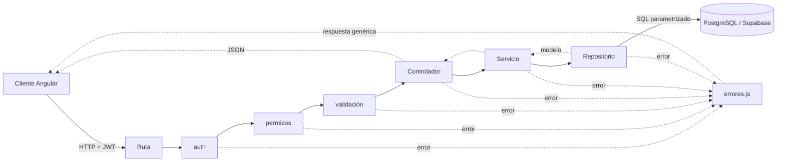

# Arquitectura del backend — Portal SIDPOL

## Estructura de carpetas del backend

```
backend/
├── server.js              Punto de entrada: valida la configuración y abre el puerto
├── app.js                 Construye la aplicación Express (middlewares globales y rutas)
├── config/                Configuración
│   ├── env.js             Carga y valida variables de entorno (falla al arrancar si falta algo)
│   ├── db.js              Pool de conexiones a PostgreSQL (Supabase)
│   └── jwt.js             Parámetros del token (secreto, algoritmo HS256, duración)
├── routes/                Capa de enrutamiento: URL + verbo HTTP → middlewares → controlador
├── middlewares/           Componentes transversales
│   ├── auth.js            Autenticación (verificación del JWT y del estado del usuario)
│   ├── permisos.js        Autorización por rol (checkRole) y por recurso (checkPermission)
│   ├── validacion.js      Cierre de las cadenas de validación de entrada
│   ├── errores.js         Manejo centralizado de errores y respuesta 404
│   └── rateLimit.js       Límite de peticiones e intentos de inicio de sesión
├── validators/            Reglas de validación de datos de entrada por recurso
├── controllers/           Capa de presentación HTTP
├── services/              Capa de lógica de negocio
├── repositories/          Capa de acceso a datos (todo el SQL)
│   └── transaccion.js     Gestión de transacciones (BEGIN / COMMIT / ROLLBACK)
├── models/                Entidades del dominio y su representación pública
├── utils/                 Utilidades: AppError y generador de username
├── migrations/            Scripts SQL versionados del esquema de base de datos
└── tests/                 Pruebas automatizadas (Jest + supertest)
```

## Flujo de una petición



## Descripción de las capas

**Rutas (`routes/`).** Definen los puntos de acceso de la API. Cada ruta asocia una URL y un método HTTP con la secuencia de middlewares que debe atravesar la petición y con el controlador que la atiende. No contienen lógica de negocio ni acceso a datos.

**Middlewares (`middlewares/`).** Implementan aspectos transversales que se aplican antes de llegar al controlador:

- **Autenticación (`auth.js`):** verifica el token JWT y consulta el estado actual del usuario, de modo que un cambio de rol o una desautorización tienen efecto inmediato.
- **Autorización (`permisos.js`):** restringe el acceso según el rol (`checkRole`) y según el recurso solicitado (`checkPermission`).
- **Validación (`validacion.js` y `validators/`):** rechaza datos de entrada mal formados antes de procesarlos.
- **Manejo de errores (`errores.js`):** traduce cualquier excepción a una respuesta controlada, sin exponer información interna como mensajes de la base de datos.
- **Límite de peticiones (`rateLimit.js`):** mitiga ataques de fuerza bruta contra el inicio de sesión.

**Controladores (`controllers/`).** Constituyen la frontera HTTP de la aplicación. Extraen los datos de la petición (parámetros, cuerpo y usuario autenticado), invocan al servicio correspondiente y construyen la respuesta con el código de estado adecuado. Gracias al manejo centralizado de errores de Express 5, no necesitan bloques `try/catch`.

**Servicios (`services/`).** Contienen las reglas de negocio del sistema. Por ejemplo:

- la generación automática del nombre de usuario y del correo institucional;
- la asignación del rol `user` a todo usuario nuevo;
- la protección que impide dejar el sistema sin administradores;
- el filtrado de módulos, submódulos y dashboards según los permisos.

Los servicios no conocen el protocolo HTTP ni el lenguaje SQL, lo que permite probarlos de forma aislada.

**Repositorios (`repositories/`).** Concentran todo el acceso a la base de datos mediante consultas SQL parametrizadas, que previenen la inyección SQL. Convierten las filas obtenidas en objetos del dominio (modelos). Aceptan un ejecutor opcional, que les permite participar en una transacción coordinada por el servicio a través de `withTransaction`.

**Modelos (`models/`).** Representan las entidades del dominio (Usuario, Módulo, Submódulo, Dashboard, Área, Posición) y definen qué atributos se exponen al cliente. Por ejemplo, la contraseña del usuario nunca forma parte de la representación pública.

**Configuración (`config/`).** Centraliza los parámetros de ejecución y los valida al iniciar el proceso. Si falta una variable obligatoria o tiene un valor inseguro, como un secreto JWT de menos de 32 caracteres, el servidor no arranca.

**Pruebas (`tests/`).** Verifican el comportamiento de la API de extremo a extremo con supertest, reemplazando la capa de repositorios por dobles de prueba. Esta separación por capas permite validar las reglas de autenticación, autorización y negocio sin depender de la base de datos real.
