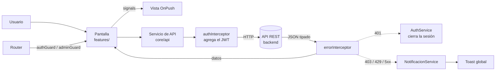

# Arquitectura del frontend — Portal SIDPOL

## Estructura de carpetas del frontend

```
frontend/sidpol-app/src/
├── index.html                 Página base (incluye la política CSP para iframes)
├── main.ts                    Arranque de la aplicación
├── environments/              Configuración por entorno (URL de la API, dominios permitidos)
└── app/
    ├── app.ts · app.html      Componente raíz (enrutador + notificaciones globales)
    ├── app.config.ts          Proveedores globales (router, HttpClient e interceptores)
    ├── app.routes.ts          Rutas principales con carga diferida (lazy loading)
    ├── core/                  Núcleo: servicios únicos de toda la aplicación
    │   ├── auth/              Sesión del usuario (AuthService con signals)
    │   ├── guards/            Protección de rutas (authGuard, adminGuard)
    │   ├── interceptors/      Token JWT y manejo global de errores HTTP
    │   ├── api/               Un servicio HTTP por recurso de la API
    │   ├── models/            Interfaces TypeScript del contrato con la API
    │   ├── notificaciones/    Cola global de notificaciones (toasts)
    │   └── seguridad/         Lista permitida de dominios para el iframe
    ├── shared/                Elementos reutilizables sin lógica de negocio
    │   ├── layout/            Estructura común: barra superior, menú lateral y perfil
    │   ├── components/        DataTable, Modal, Toast y aviso "sin accesos"
    │   ├── utils/             Búsqueda y estado de errores de formularios
    │   └── styles/            Estilos comunes de tablas, modales y formularios
    ├── features/              Funcionalidades del sistema (una carpeta por pantalla)
    │   ├── login/             Inicio de sesión
    │   ├── inicio/            Página principal
    │   ├── visor/             Visualización de dashboards de Power BI
    │   └── configuracion/     Administración (solo admin): módulos, submódulos,
    │                          áreas, dashboards y usuarios
    └── testing/               Utilidades para las pruebas automatizadas
```

## Flujo de una petición



## Descripción de las partes

**Configuración y arranque (`main.ts`, `app.config.ts`, `environments/`).** Inicializan la aplicación y registran los servicios globales: el enrutador, el cliente HTTP y los interceptores. Los archivos de entorno separan la configuración de desarrollo de la de producción, por ejemplo la dirección de la API, sin modificar el código.

**Enrutamiento (`app.routes.ts` y `configuracion.routes.ts`).** Definen la navegación del sistema. Cada pantalla se carga solo cuando se necesita (_lazy loading_), lo que reduce el tamaño inicial de la aplicación. Las rutas internas están protegidas por guards.

**Núcleo (`core/`).** Agrupa los servicios que existen una sola vez en toda la aplicación:

- **Autenticación (`auth/`):** gestiona la sesión y expone el usuario actual y su rol mediante _signals_.
- **Guards (`guards/`):** `authGuard` impide el acceso sin sesión, y `adminGuard` hace que las rutas de configuración solo existan para el administrador.
- **Interceptores (`interceptors/`):** añaden el token JWT únicamente a las peticiones dirigidas a la API y centralizan el tratamiento de errores. Ante un 401 cierran la sesión, y ante 403, 429 o errores del servidor muestran una notificación.
- **Servicios de API (`api/`):** un servicio por recurso (módulos, submódulos, áreas, posiciones, dashboards y usuarios). Encapsulan las peticiones HTTP y devuelven datos tipados.
- **Modelos (`models/`):** interfaces TypeScript que describen exactamente el JSON de la API, lo que permite detectar errores en tiempo de compilación.
- **Notificaciones (`notificaciones/`):** cola global de mensajes breves (_toasts_) que se muestran en un único componente.
- **Seguridad (`seguridad/`):** valida que los enlaces de los dashboards pertenezcan a un dominio permitido (`https://app.powerbi.com`) antes de mostrarlos en un iframe. El backend aplica la misma regla.

**Elementos compartidos (`shared/`).** Contiene piezas reutilizables sin lógica de negocio:

- **Layout:** la estructura común de las pantallas internas (barra superior, menú lateral construido con los permisos que entrega el backend, y perfil).
- **`DataTable`:** tabla con buscador, botón de alta y estados de carga y vacío.
- **`Modal`:** ventana emergente con título, contenido y acciones.
- **`Toast`:** muestra las notificaciones globales.
- **Utilidades y estilos comunes:** evitan duplicar código entre pantallas.

**Funcionalidades (`features/`).** Cada carpeta corresponde a una pantalla del sistema. Los componentes guardan su estado en _signals_ y usan la estrategia de detección de cambios _OnPush_, de modo que la vista se actualiza solo cuando sus datos cambian. Delegan la comunicación con el servidor en los servicios de `core/api` y la presentación común en los componentes de `shared/`. El visor muestra los reportes de Power BI en un iframe restringido (_sandbox_) que conserva la función de pantalla completa.

**Pruebas (`*.spec.ts` y `testing/`).** Verifican con Vitest el comportamiento de servicios, guards, interceptores, componentes compartidos y pantallas. Simulan el servidor con `HttpTestingController`, por lo que no dependen de la API real.
