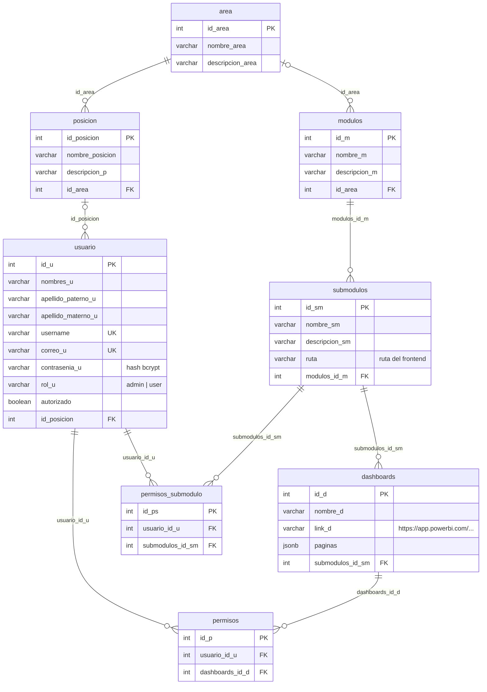

# Base de datos — Portal SIDPOL

PostgreSQL alojado en Supabase. El backend se conecta con el usuario `postgres`;
la API pública de Supabase (`anon` / `authenticated`) no tiene acceso a ninguna
tabla (RLS activo y privilegios revocados, ver `backend/migrations/002_rls.sql`).

## Diagrama entidad-relación

## Tablas

| Tabla | Para qué sirve |
|---|---|
| `area` | Dependencias de la institución (en el menú: "Dependencias"). |
| `posicion` | Cargos o puestos; cada uno pertenece a un área. |
| `usuario` | Personas que usan el portal. `rol_u` es `admin` o `user` (CHECK). `username` y `correo_u` (`username@sidpol.pe`) los genera el backend y son únicos. `contrasenia_u` guarda un hash bcrypt (cost 12). |
| `modulos` | Agrupaciones del menú (por ejemplo, "Análisis Temporal"). |
| `submodulos` | Opciones dentro de un módulo. `ruta` es la ruta de la pantalla en el frontend (`visor/6`, `configuracion/usuarios`); si es nula, el menú abre `visor/<id_sm>`. Los que empiezan con `configuracion/` son exclusivos del administrador. |
| `dashboards` | Reportes de Power BI de un submódulo. `link_d` solo admite `https://app.powerbi.com` (validado en backend y frontend). `paginas` es una lista `[{ nombre, seccion }]`. |
| `permisos` | Permiso de un usuario sobre un **dashboard**. |
| `permisos_submodulo` | Permiso de un usuario sobre un **submódulo completo** (todos sus dashboards, incluidos los futuros). |

Restricciones relevantes: `UNIQUE (usuario_id_u, dashboards_id_d)` en `permisos`,
`UNIQUE (usuario_id_u, submodulos_id_sm)` en `permisos_submodulo`, índices en todas
las claves foráneas (`backend/migrations/003_indices_fk.sql`).

## Criterio de nombres

### Cómo está hoy

La base se diseñó antes de este proyecto de mejora y no se renombró (cambiar
columnas obligaría a migrar datos y a tocar todas las consultas). Este es el
criterio que siguen las tablas existentes:

| Elemento | Regla | Ejemplos |
|---|---|---|
| Nombres | `snake_case`, en español, sin tildes | `apellido_paterno_u`, `descripcion_area` |
| Tablas | Mezcla de singular y plural | `usuario`, `area`, `posicion` / `modulos`, `submodulos`, `dashboards`, `permisos` |
| Sufijo de tabla | Cada tabla tiene un sufijo corto que se agrega a sus columnas | `usuario` → `_u`, `modulos` → `_m`, `submodulos` → `_sm`, `dashboards` → `_d`, `permisos` → `_p`, `permisos_submodulo` → `_ps` |
| Clave primaria | `id_<sufijo>` | `id_u`, `id_m`, `id_sm`, `id_d` |
| Columnas | `<campo>_<sufijo>` | `nombre_m`, `correo_u`, `link_d` |
| Clave foránea (estilo 1) | `<tabla_referenciada>_id_<sufijo>` | `submodulos_id_sm`, `modulos_id_m`, `usuario_id_u` |

**Excepciones conocidas:**

- `area` y `posicion` usan el nombre completo como sufijo (`id_area`, `nombre_area`,
  `nombre_posicion`), salvo `descripcion_p`.
- Sus claves foráneas usan un segundo estilo: `id_<tabla>` (`id_area`, `id_posicion`).
- Columnas sin sufijo: `username`, `autorizado`, `paginas`, `ruta`.

### Convención para tablas nuevas

Para no aumentar la mezcla, las tablas nuevas deben seguir el estilo mayoritario:

1. Nombre de tabla en **plural** y `snake_case` (`auditorias`, `reportes_programados`).
2. Un **sufijo corto** propio, documentado en la tabla de arriba.
3. Clave primaria `id_<sufijo>`; columnas `<campo>_<sufijo>`.
4. Claves foráneas `<tabla_referenciada>_id_<sufijo_referenciado>` (estilo 1),
   con índice y `ON DELETE` explícito.
5. Valores booleanos como adjetivo sin sufijo (`activo`, `autorizado`).

### Correspondencia con la API

La API REST nombra los recursos en **plural** aunque la tabla esté en singular
(`/api/usuarios` → tabla `usuario`, `/api/areas` → `area`, `/api/posiciones` →
`posicion`). Los nombres de campos del JSON son los mismos de las columnas, para
que el contrato sea directo de seguir.

## Migraciones

Se ejecutan manualmente en Supabase → SQL Editor, en orden. Son idempotentes.

| Archivo | Contenido |
|---|---|
| `001_fase0.sql` | Contraseñas a bcrypt, nombres separados, roles en minúscula, correo institucional, tabla `permisos_submodulo`. |
| `002_rls.sql` | RLS en todas las tablas de `public` y revocación de privilegios a `anon` / `authenticated`. |
| `003_indices_fk.sql` | Índices para todas las claves foráneas y eliminación de un índice duplicado. |
